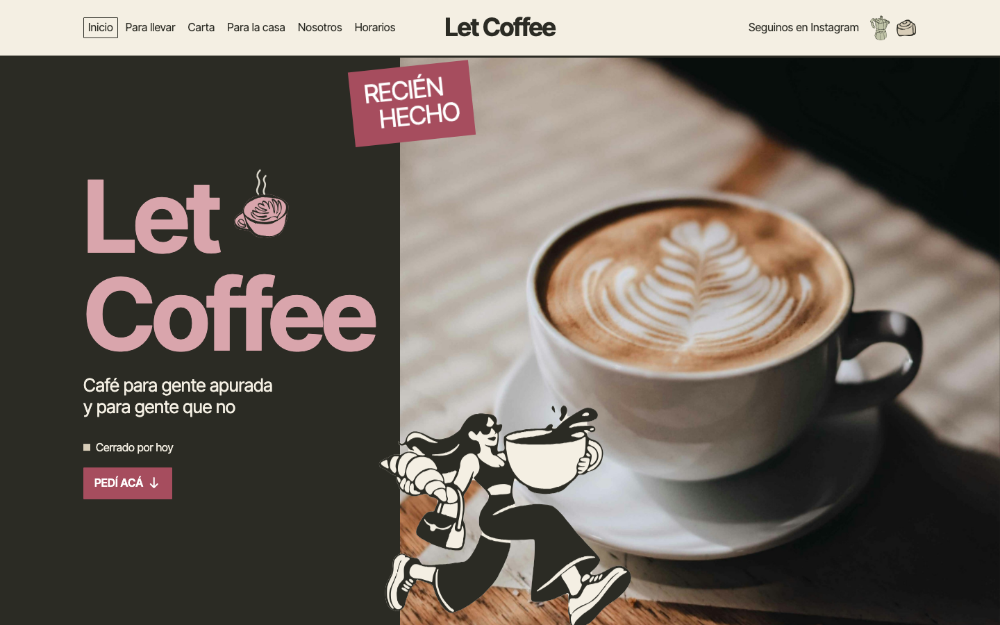
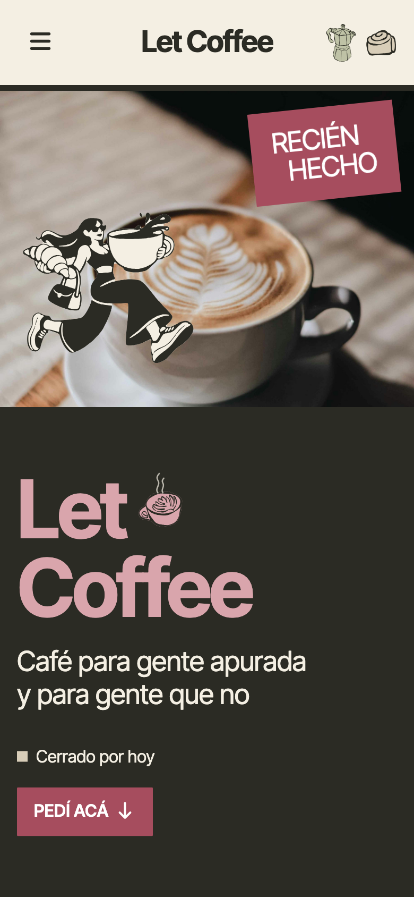
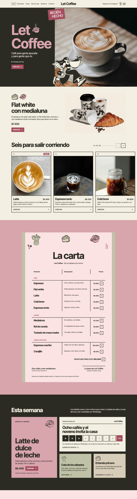

# Let Coffee — sitio web

Sitio responsive para **Let Coffee**, un café bar de Resistencia, Chaco. Forma parte de un proyecto completo de identidad de marca y web, diseñado y desarrollado por Rush Design.

**🔗 Demo en vivo: [let-coffee.rushdesign.workers.dev](https://let-coffee.rushdesign.workers.dev/)**
**🎨 Identidad de marca: [let-coffee-branding-showcase](https://github.com/rush71/let-coffee-branding-showcase)**

## Qué resuelve
- Una carta clara, con precios y botón para agregar cada producto.
- Secciones pensadas para quien va apurado: **Para llevar**, bebida de la semana y estado del local ("Abierto/Cerrado por hoy").
- Tarjeta de sellos y novedades, con contacto directo por WhatsApp.
- La marca (logo, ilustraciones, paleta y tipografía) aplicada de punta a punta en pantalla.

## Responsive

## Página completa (escritorio)

## Tecnologías
Angular · TypeScript · Diseño responsive · Desplegado en Cloudflare

## Nota
El código fuente es privado. Este repositorio muestra el resultado del trabajo.

© 2026 Francisco Montilla — Rush Design. Todos los derechos reservados.
